# Deploying a MERN Application on AWS with Terraform and Ansible

This repository provisions AWS infrastructure with **Terraform** and configures, deploys and hardens the [TravelMemory](https://github.com/UnpredictablePrashant/TravelMemory) MERN application with **Ansible**. Nothing on the servers is configured by hand: Terraform builds the network and instances, and a single `ansible-playbook site.yml` turns two blank Ubuntu servers into a working, hardened application stack.

| | |
|---|---|
| **Cloud / Region** | AWS, `ap-southeast-2` (Sydney) |
| **IaC** | Terraform v1.16, AWS provider v6.x |
| **Configuration management** | Ansible core 2.21 |
| **OS** | Ubuntu 24.04 LTS (both instances) |
| **Application** | React frontend, Express/Node.js 22 backend, MongoDB 8.0 |

---

## 1. Architecture

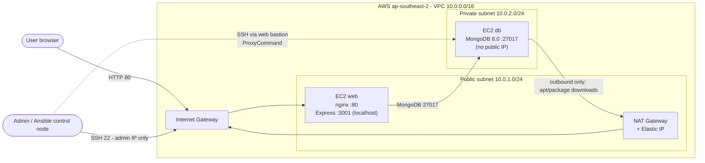

The design follows a classic two-tier pattern:

- **Public subnet:** the web server, which is the only instance reachable from the internet. It also acts as the SSH bastion for the private subnet.
- **Private subnet:** the database server. It has no public IP and accepts connections only from the web server's security group. It reaches the internet *outbound only* through the NAT Gateway, so it can download packages but cannot be reached from outside.

### Network routing

| Route table | Subnet | Default route (`0.0.0.0/0`) |
|---|---|---|
| `mern-tf-public-rt` | Public 10.0.1.0/24 | Internet Gateway |
| `mern-tf-private-rt` | Private 10.0.2.0/24 | NAT Gateway |

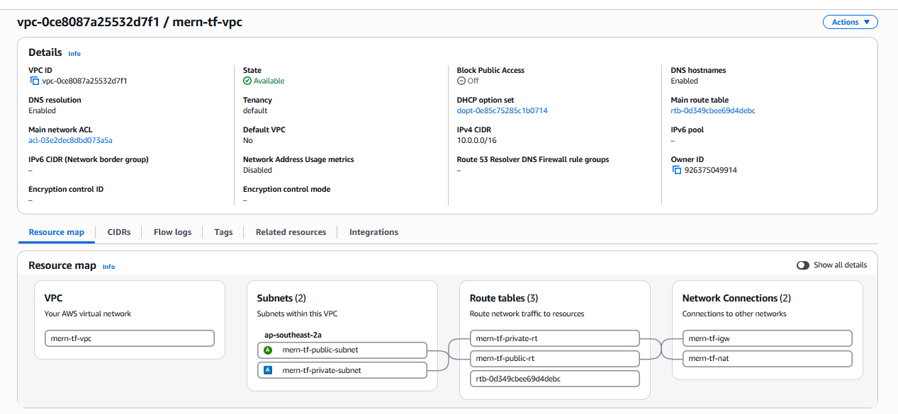

---

## 2. Repository structure

```
mern-terraform-ansible/
├── terraform/
│   ├── providers.tf              # AWS provider, default tags
│   ├── variables.tf              # CIDRs, instance type, admin IP, key path
│   ├── vpc.tf                    # VPC, subnets, IGW, NAT, route tables
│   ├── security.tf               # web-sg and db-sg
│   ├── iam.tf                    # EC2 role + instance profile (SSM)
│   ├── ec2.tf                    # AMI lookup, key pair, web + db instances
│   ├── outputs.tf                # web public IP, db private IP
│   └── terraform.tfvars.example  # template for the admin IP (real file is gitignored)
├── ansible/
│   ├── ansible.cfg
│   ├── gen_inventory.sh          # builds inventory.ini from Terraform outputs
│   ├── site.yml                  # full run: db -> web -> hardening
│   ├── db.yml / web.yml / hardening.yml
│   ├── group_vars/
│   │   ├── all/vars.yml          # MongoDB names (non-secret)
│   │   ├── all/vault.yml         # MongoDB passwords (Ansible Vault, AES256)
│   │   ├── webservers.yml        # UFW rules for web tier
│   │   └── dbservers.yml         # UFW rules for db tier
│   └── roles/
│       ├── mongodb/              # install, configure, secure MongoDB, create users
│       ├── web/                  # Node.js, app clone/build, systemd backend, nginx
│       └── hardening/            # UFW, SSH hardening, fail2ban, auto security updates
└── docs/screenshots/
```

---

## 3. Part 1: Infrastructure with Terraform

### 3.1 AWS setup and initialisation

A dedicated IAM user, `terraform-mern`, was created for Terraform instead of using root credentials. It has programmatic access only and two managed policies: `AmazonEC2FullAccess` (EC2 and VPC resources) and `IAMFullAccess` (needed to create the EC2 instance role). Its credentials live in a named AWS CLI profile, `mern-tf`, which keeps them separate from any other credentials on the machine.

```bash
aws configure --profile mern-tf
aws sts get-caller-identity --profile mern-tf
cd terraform && terraform init
```

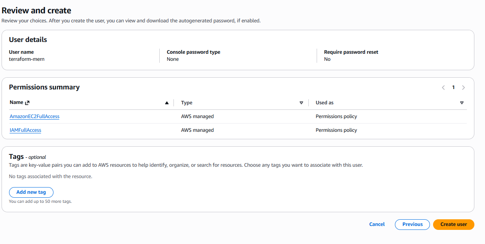
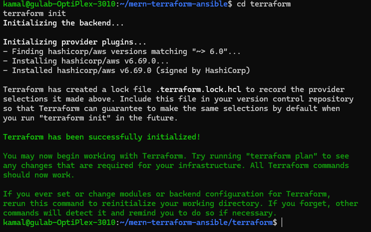

### 3.2 Resources created

| File | Resources | Notes |
|---|---|---|
| `vpc.tf` | VPC, 2 subnets, IGW, EIP, NAT Gateway, 2 route tables, 2 associations | DNS hostnames enabled; NAT `depends_on` the IGW |
| `security.tf` | `web-sg`, `db-sg` | see the port matrix in section 5 |
| `iam.tf` | IAM role, `AmazonSSMManagedInstanceCore` attachment, instance profile | least privilege; SSM provides break-glass access |
| `ec2.tf` | key pair, `web` instance, `db` instance | Ubuntu 24.04 AMI looked up dynamically; IMDSv2 required; encrypted gp3 root volumes |
| `outputs.tf` | `web_public_ip`, `db_private_ip` | the assignment asks for the public IP; the private IP feeds Ansible |

All 18 resources carry `Project = mern-tf` and `ManagedBy = Terraform` tags through the provider's `default_tags`.

**Key decisions:**

- **The SSH key pair is generated locally** (`ssh-keygen -t ed25519`). Terraform uploads only the public key, so the private key never appears in AWS or in the Terraform state.
- **The admin IP is a variable** (`my_ip`) kept in a gitignored `terraform.tfvars`. Only that /32 can reach port 22 on the web server.
- **The DB instance `depends_on` the NAT Gateway**, so it has outbound internet access from its very first boot.

```bash
terraform plan     # Plan: 18 to add
terraform apply
```

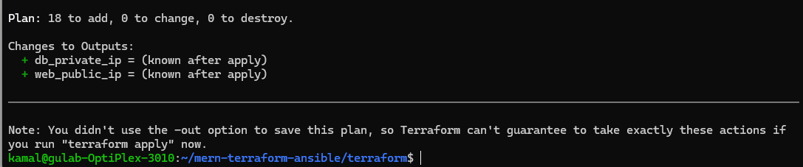
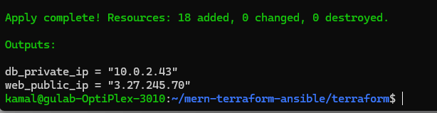
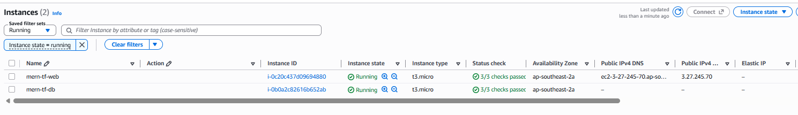

---

## 4. Part 2: Configuration and deployment with Ansible

### 4.1 Ansible to EC2 connectivity

`gen_inventory.sh` reads the Terraform outputs and writes `inventory.ini`. That script is the hand-off between the two tools: if the infrastructure is rebuilt with new IPs, re-running the script is the only step needed.

- **web** is reached directly over SSH from the admin IP.
- **db** has no public IP, so Ansible reaches it **through the web server as a bastion**, using an SSH `ProxyCommand` (`ssh -W %h:%p ubuntu@<web>`). This works because `db-sg` allows port 22 only from `web-sg`.
- `ansible.cfg` sets `StrictHostKeyChecking=accept-new`. New hosts are trusted on first contact, but a *changed* host key is still rejected, which is safer than disabling host key checking.

```bash
cd ansible
./gen_inventory.sh
ansible all -m ping
```

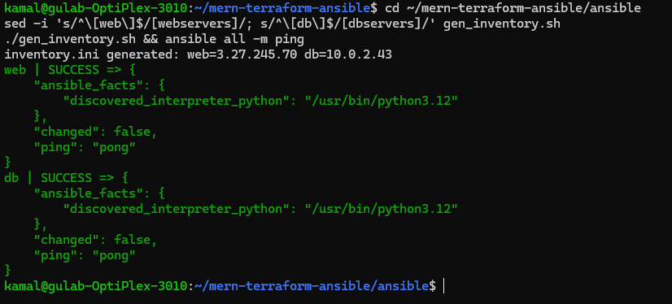
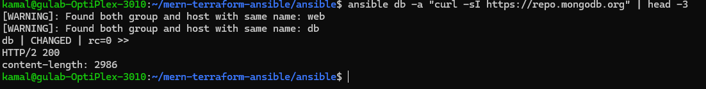

### 4.2 Database server: `roles/mongodb`

1. Adds the official MongoDB 8.0 apt repository in deb822 format, with a pinned signing key, and installs `mongodb-org`.
2. Applies a systemd drop-in that works around the kernel 6.19+ incompatibility (see section 7).
3. Deploys a hardened `mongod.conf`:
   - `bindIp` is set to `127.0.0.1` plus the instance's private IP only, never `0.0.0.0`.
   - `security.authorization: enabled` is on **from the first start**.
4. Creates the **admin** user through MongoDB's localhost exception, on the first run only.
5. Creates a least-privilege **application user**, `tmapp`, with `readWrite` on the `travelmemory` database only.

Both passwords are randomly generated and stored in `group_vars/all/vault.yml`, which is **encrypted with Ansible Vault** (AES256). The vault password file lives outside the repository with mode 600. Every task that handles a password uses `no_log: true`.

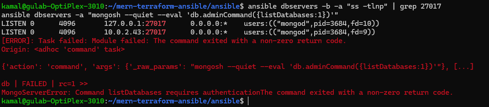

*MongoDB listens only on localhost and the private IP, and anonymous commands are refused with "requires authentication".*

### 4.3 Web server: `roles/web`

1. Creates a 2 GB swap file, because the React production build needs more than the 1 GB of RAM on a t3.micro.
2. Installs nginx, git, and **Node.js 22 LTS** from the NodeSource repository.
3. Creates a dedicated, **non-login system user**, `travelmemory`, which owns the code under `/opt/travelmemory` (mode 750).
4. Clones the TravelMemory repository.
5. **Backend:**
   - Renders `backend/.env` from the vault with `MONGO_URI` (pointing at the DB's private IP) and `PORT=3001`. The file is mode 600.
   - Runs `npm install`, then runs Express as a **systemd service** with sandboxing: `NoNewPrivileges`, `ProtectSystem=strict`, `ProtectHome`, `PrivateTmp` and `PrivateDevices`.
6. **Frontend:**
   - Sets `src/url.js` to `baseUrl = "/api"`.
   - Runs `npm install` and `npm run build`, then publishes the build to `/var/www/travelmemory`.
7. **nginx:**
   - Serves the React build and reverse-proxies `/api/*` to Express on `127.0.0.1:3001`, stripping the `/api` prefix.
   - Disables the default site and adds `server_tokens off` and basic security headers.

Running the backend under systemd rather than PM2 means it starts on boot and restarts on failure with no extra tooling. It also lets the process be sandboxed by the init system.

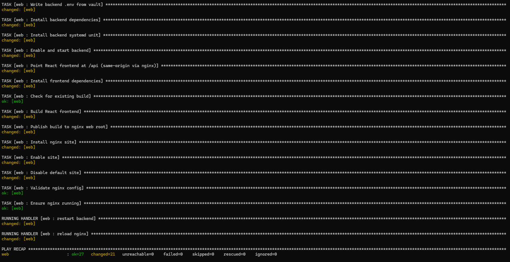
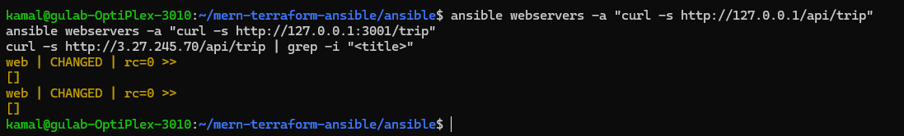
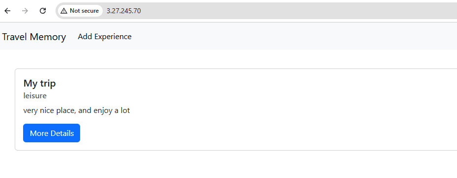
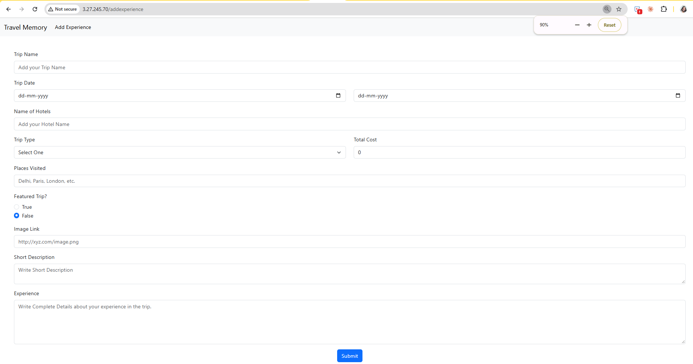
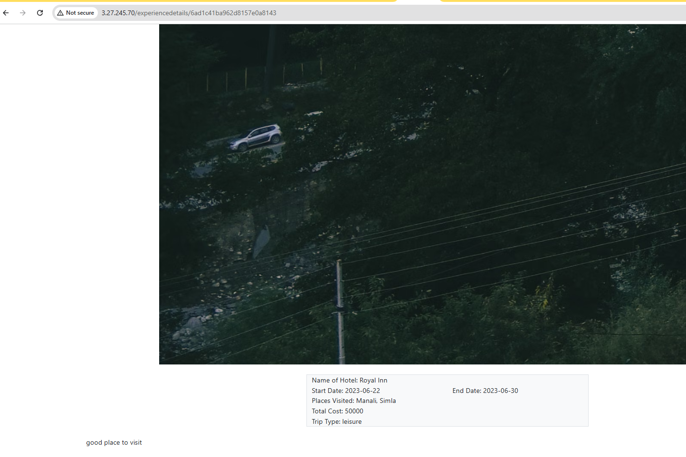
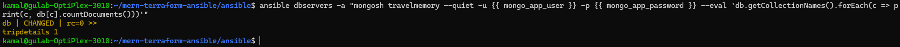

### 4.4 Security hardening: `roles/hardening`

This role is applied to both servers. Details are in section 5.

### 4.5 Full run and idempotency

```bash
ansible-playbook site.yml    # db.yml -> web.yml -> hardening.yml
```

A second run of `site.yml` reports **`changed=0` on both hosts**. The playbooks are idempotent: they converge the servers to the desired state and leave them alone once they are there.

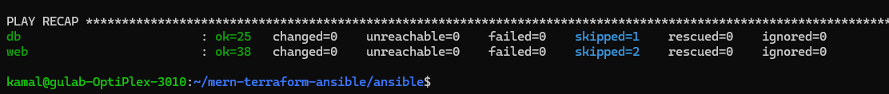

---

## 5. How the components interact

### 5.1 Request flow

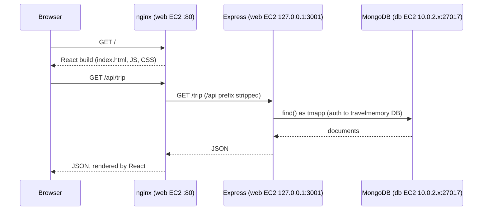

- **Frontend to backend:** the React app is built with `baseUrl = "/api"`, so every API call goes to the same origin that served the page. nginx routes `/api/*` to Express. There are no hard-coded IPs in the frontend and no CORS configuration is needed, so the build works unchanged on any IP or domain.
- **Backend to database:** Express connects using `MONGO_URI` from its `.env`. The connection crosses from the public subnet to the private subnet over the VPC's local route, and is allowed by `db-sg` (source `web-sg`) and by UFW on the DB host (source `10.0.1.0/24`).
- **Database to internet:** outbound traffic only, through the NAT Gateway, for package installation and updates.

### 5.2 Port matrix (defense in depth)

| Port | Web server | DB server |
|---|---|---|
| 22/tcp | SG: admin IP /32 only. UFW: allow | SG: `web-sg` only. UFW: 10.0.1.0/24 only |
| 80, 443/tcp | SG and UFW: internet | not open |
| 3001/tcp | **not exposed**: SG has no rule, so only nginx reaches it on localhost | not open |
| 27017/tcp | not open | SG: `web-sg` only. UFW: 10.0.1.0/24 only. `bindIp` limited to the private IP |

Each sensitive port is filtered at two or three layers: the AWS security group, the UFW host firewall, and the service's own bind address.

---

## 6. Security measures

| Area | Control |
|---|---|
| **AWS access** | Dedicated IAM user with programmatic access only and a named CLI profile; no root credentials |
| **Secrets in git** | `*.tfvars`, `*.pem`, state files and `inventory.ini` are gitignored; MongoDB passwords are vault-encrypted |
| **Network** | DB in a private subnet with no public IP; SSH to the web tier only from the admin IP; DB reachable only from `web-sg` |
| **Host firewall** | UFW on both hosts: default deny inbound, explicit allow rules, logging on |
| **SSH** | Key-only (ed25519); `PermitRootLogin no`; `PasswordAuthentication no`; `KbdInteractiveAuthentication no`; `MaxAuthTries 3`; `AllowUsers ubuntu`; idle timeout. The drop-in is named `00-hardening.conf` because sshd uses the *first* value it reads, so it must load before Ubuntu's `60-cloudimg-settings.conf` |
| **Brute-force protection** | fail2ban sshd jail on both hosts: 5 failures in 10 minutes gives a 1 hour ban |
| **Patching** | `unattended-upgrades` enabled for automatic security updates |
| **EC2** | IMDSv2 required, which blocks SSRF-style credential theft through IMDSv1; encrypted root volumes; SSM role for break-glass access |
| **MongoDB** | Authentication enforced; restricted `bindIp`; separate admin and least-privilege app users |
| **Application** | Runs as a non-login service user; systemd sandboxing; `.env` mode 600; Express not exposed; nginx hides its version and sends security headers |

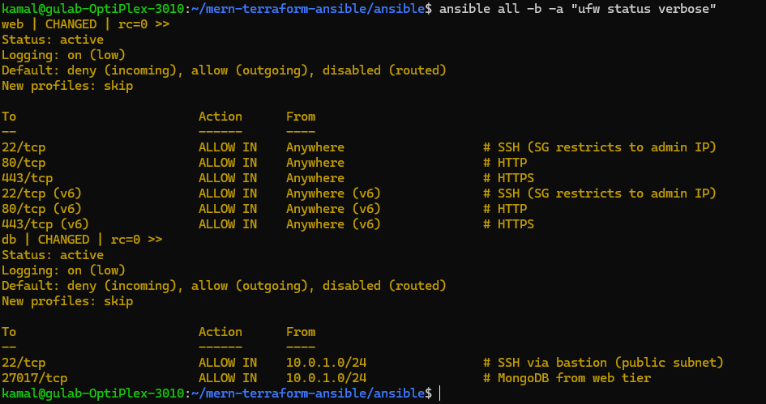
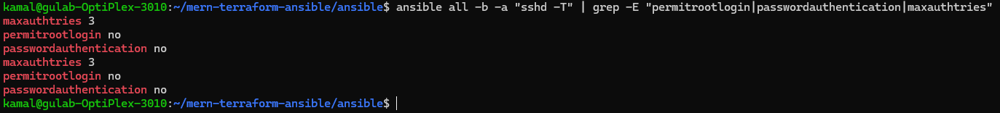
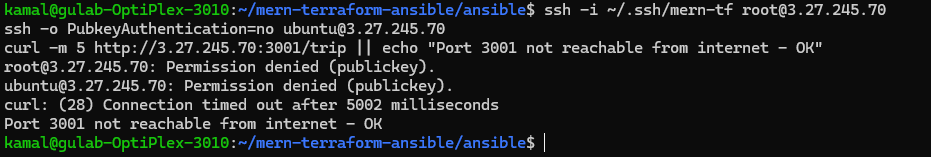
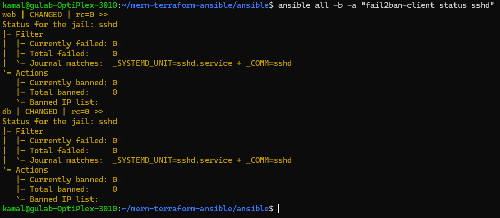

---

## 7. Problems encountered and resolutions

### 7.1 MongoDB 8.0 refused to start on Linux kernel 7.0

**Symptom:** the playbook timed out waiting for port 27017. `journalctl -u mongod` showed:

> MongoDB cannot start: Linux kernel versions 6.19 and newer has a known incompatibility with this version of MongoDB. See SERVER-121912.

**Root cause:** the current Ubuntu 24.04 AWS AMI ships kernel 7.0. The TCMalloc allocator bundled with MongoDB 8.x is incompatible with the restartable-sequences (rseq) behaviour in kernel 6.19 and newer ([SERVER-121912](https://jira.mongodb.org/browse/SERVER-121912)). Upgrading within 8.x does not help.

**Resolution:** the `mongodb` role installs a systemd drop-in, `/etc/systemd/system/mongod.service.d/rseq-workaround.conf`, that sets `GLIBC_TUNABLES=glibc.pthread.rseq=1` in mongod's environment. This keeps the latest AMI and avoids pinning an old kernel. It should be removed once MongoDB ships a fixed release.

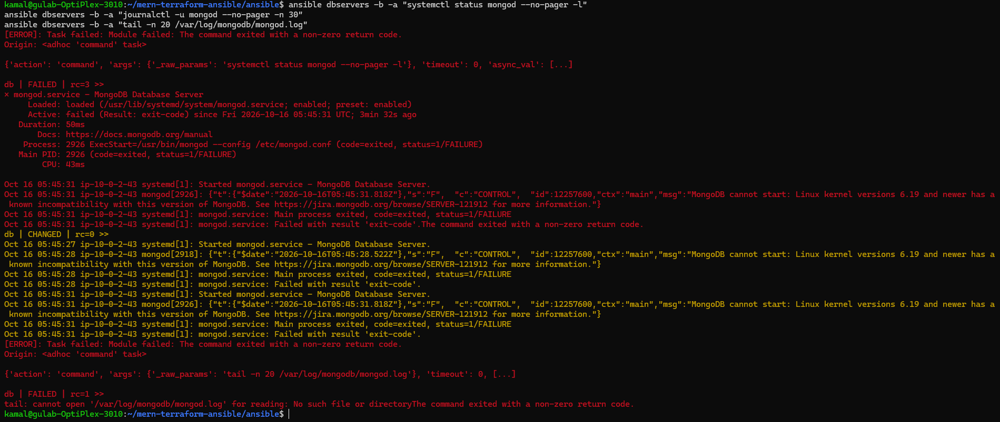
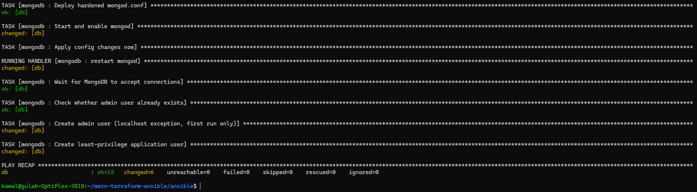

### 7.2 Making the web deployment idempotent

**Symptom:** a repeat run of `site.yml` reported `changed=4` on the web server even though nothing had changed.

**Root cause:** the role edits `frontend/src/url.js`, a tracked file. The `git` task with `force: true` reset that edit on every run, which re-triggered the `url.js` write, the React build and the publish step.

**Resolution:** the clone now uses `force: false`, and `git update-index --skip-worktree frontend/src/url.js` runs before the update (for existing checkouts) and after the clone (for fresh ones). Git ignores the intentional local override, and a repeat run reports `changed=0`.

### 7.3 Ansible deprecation warnings

`ansible.builtin.apt_repository` is deprecated, and will be removed in ansible-core 2.25. Both roles now use `ansible.builtin.deb822_repository`, the native `.sources` format on Ubuntu 24.04, and remove the legacy `.list` files. Template facts use `ansible_facts['…']` instead of injected top-level variables.

---

## 8. How to reproduce

```bash
# Prerequisites: AWS CLI v2, Terraform >= 1.6, Ansible core >= 2.17, an AWS CLI profile "mern-tf"
ssh-keygen -t ed25519 -f ~/.ssh/mern-tf -C "mern-tf" -N ""

# 1. Infrastructure
cd terraform
echo "my_ip = \"$(curl -s https://checkip.amazonaws.com)/32\"" > terraform.tfvars
terraform init && terraform apply

# 2. Configuration and deployment
cd ../ansible
# create ~/.ansible-vault-pass (chmod 600) and your own encrypted group_vars/all/vault.yml with
#   vault_mongo_admin_password / vault_mongo_app_password
./gen_inventory.sh
ansible-playbook site.yml

# 3. Open http://<web_public_ip>
```

## 9. Teardown and cost

The NAT Gateway and its Elastic IP are billed hourly, so the environment is destroyed after testing:

```bash
cd terraform && terraform destroy
```

After teardown, the `terraform-mern` IAM user's access key is deactivated.

<!-- After running terraform destroy, add docs/screenshots/26-terraform-destroy.png and uncomment:
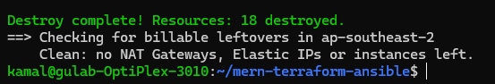
-->

---

## 10. Assignment requirements mapping

| Requirement | Where it is implemented |
|---|---|
| Configure AWS CLI, initialise Terraform | Section 3.1, `providers.tf` |
| VPC with public and private subnets | `vpc.tf` |
| Internet Gateway and NAT Gateway | `vpc.tf` |
| Route tables for both subnets | `vpc.tf` (`public` to IGW, `private` to NAT) |
| Web EC2 in the public subnet, DB EC2 in the private subnet | `ec2.tf` |
| SSH access, public instance only from the admin IP | `security.tf`, bastion `ProxyCommand` in `gen_inventory.sh` |
| Security groups for web and DB | `security.tf` |
| IAM roles for EC2 | `iam.tf` |
| Output the web server public IP | `outputs.tf` |
| Configure Ansible to reach EC2 | `ansible.cfg`, `gen_inventory.sh` |
| Install Node.js and npm, clone the app, install dependencies | `roles/web` |
| Install and configure MongoDB | `roles/mongodb` |
| Secure MongoDB, create users and databases | `roles/mongodb`, vault, section 4.2 |
| Environment variables, start the Node.js app | `backend.env.j2`, systemd unit |
| React frontend communicates with the Express backend | `url.js` set to `/api`, nginx reverse proxy, section 5.1 |
| Firewalls and security groups | `roles/hardening` (UFW), `security.tf` |
| Additional security measures (SSH keys, no root login, etc.) | Section 6 |
| Screenshots of the working application | `docs/screenshots/` |

---

## 11. Screenshot index

| # | Screenshot | Shows |
|---|---|---|
| 01 | [repo created](docs/screenshots/01-repo-created.png) | GitHub repository with Terraform `.gitignore` |
| 02 | [tool versions](docs/screenshots/02-tool-versions.png) | AWS CLI, Terraform, Ansible, git installed |
| 03 | [IAM user](docs/screenshots/03-iam-user-permissions.png) | `terraform-mern` user and its policies |
| 04 | [STS identity](docs/screenshots/04-sts-identity.png) | CLI profile authenticates as the IAM user |
| 05 | [terraform init](docs/screenshots/05-terraform-init.png) | AWS provider installed, lock file created |
| 06 | [gitignore check](docs/screenshots/06-gitignore-check.png) | `terraform.tfvars` excluded from git |
| 07 | [plan: network](docs/screenshots/07-terraform-plan-vpc.png) | 10 networking resources planned |
| 07b | [plan: full](docs/screenshots/07b-terraform-plan-full.png) | 18 resources planned |
| 08 | [apply and outputs](docs/screenshots/08-terraform-apply-outputs.png) | 18 resources created, public/private IP outputs |
| 09 | [VPC resource map](docs/screenshots/09-vpc-resource-map.png) | subnets, route tables, IGW, NAT |
| 10 | [EC2 instances](docs/screenshots/10-ec2-instances.png) | web (public IP) and db (no public IP) running |
| 11 | [SSH to web](docs/screenshots/11-ssh-web.png) | key-based SSH login |
| 12 | [ansible ping](docs/screenshots/12-ansible-ping.png) | both hosts reachable, db via bastion |
| 13 | [DB egress via NAT](docs/screenshots/13-db-nat-egress.png) | private DB reaches the internet outbound |
| 14 | [MongoDB kernel error](docs/screenshots/14-mongodb-kernel-error.png) | kernel 6.19+ incompatibility (section 7.1) |
| 15 | [MongoDB recap](docs/screenshots/15-mongodb-playbook-recap.png) | db.yml succeeds after the workaround |
| 16 | [MongoDB verification](docs/screenshots/16-mongodb-verification.png) | restricted bind IP, authentication enforced |
| 17 | [web recap](docs/screenshots/17-web-playbook-recap.png) | web.yml succeeds |
| 17b | [API test](docs/screenshots/17b-api-test-from-server.png) | nginx `/api` and Express both return JSON |
| 18 | [app home](docs/screenshots/18-app-home.png) | TravelMemory listing a saved trip |
| 19 | [add experience](docs/screenshots/19-app-add-experience.png) | create form |
| 20 | [experience details](docs/screenshots/20-app-details.png) | details page |
| 21 | [data in MongoDB](docs/screenshots/21-mongodb-data.png) | `tripdetails` collection on the private DB |
| 22 | [UFW status](docs/screenshots/22-ufw-status.png) | host firewall rules on both hosts |
| 23 | [sshd checks](docs/screenshots/23-sshd-checks.png) | root login and passwords disabled |
| 23b | [logins denied](docs/screenshots/23b-ssh-login-denied.png) | root and password logins rejected, port 3001 closed |
| 24 | [fail2ban](docs/screenshots/24-fail2ban.png) | sshd jail active on both hosts |
| 25 | [idempotency](docs/screenshots/25-idempotency-changed-0.png) | repeat `site.yml` run: `changed=0` |
